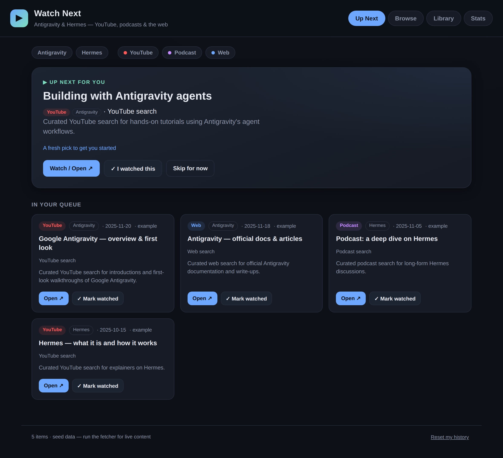

# Antigravity & Hermes — Watch Next

A personal watch-tracker and recommender for **Antigravity** and **Hermes**
content across **YouTube, podcasts, and the web**. It shows you what to watch
next, and when you mark something watched it asks whether you **liked it** —
then uses your 👍 / 👎 to sharpen future picks.



> ⚠️ **Security lab target.** The Cloud Run backend in this folder is
> **intentionally vulnerable** (SQL injection, path traversal, a plaintext DB
> password, an end-of-life base image) so the fixes can be demonstrated with the
> CodeMender + Wiz MCP lab. See [SECURITY-LAB.md](SECURITY-LAB.md). Do not run it
> anywhere you care about.

## How it works

```
 MySQL `sources` ──► fetch_media.py ──► MySQL `items` ──► Flask API ──► web app
   (where to look)     (aggregator)      (the content)    /api/catalog   (Up Next / Browse / Library / Stats)
```

- **Flask + MySQL on Cloud Run.** `data/sources.json` and `data/catalog.json`
  are the seed: on start-up the backend loads them into the MySQL tables
  `sources`, `items` and `meta`, and the web app reads the catalog from
  `/api/catalog`. Your watched/liked history is still stored in your browser's
  `localStorage`, so it stays on your device.
- **Still works as a static site.** With no backend (plain `http.server`,
  GitHub Pages) the web app falls back to `data/catalog.json`.
- **The recommender** ranks unwatched items by your taste: topics, sources, and
  creators you've 👍'd score higher; 👎'd ones score lower; newer items get a
  recency boost. The top pick appears as the **Up Next** hero with a short
  "recommended because…" explanation.
- **The watched → liked loop:** mark an item watched (on the hero or any card)
  and it moves to your **Library** with a "Did you like it?" prompt. Rating it
  feeds straight back into the ranking.

## Quick start

The app must be served over HTTP (browsers block `fetch` of local files over
`file://`).

```bash
# from the repo root
python3 -m http.server 8000
# then open http://localhost:8000/web/
```

or use the helper:

```bash
./scripts/serve.sh        # serves on http://localhost:8000/web/
```

It ships with **seed data** (real YouTube/web *search* links) so it works
immediately. Run the fetcher to replace it with live content.

## Pulling live content

1. Edit **`data/sources.json`**:
   - `youtube.search_terms` / `youtube.channel_ids` — what to index on YouTube
   - `podcasts.feeds` — podcast RSS feed URLs
   - `websites.pages` — pages to scrape links from (with an optional CSS-ish hint)
   - `match` — regexes that tag an item as **Antigravity** and/or **Hermes**
2. For YouTube, get a free **YouTube Data API v3** key
   (Google Cloud Console → APIs & Services → enable *YouTube Data API v3* →
   create an API key) and export it:
   ```bash
   export YOUTUBE_API_KEY=your_key_here
   ```
3. Run the fetcher (Python 3.9+, **no third-party packages required**):
   ```bash
   python3 scripts/fetch_media.py
   ```
   It writes `data/catalog.json`. Reload the web app to see the new items.

Each source degrades gracefully — a missing API key or an unreachable feed is
skipped with a warning, and the other sources still run.

### Keep it fresh automatically

The backend keeps the catalog current by itself. With
`REFRESH_INTERVAL_MINUTES` set, it runs the fetcher **once at start-up and then
every N minutes**, reading the `sources` table and replacing the `items` table
with what it finds. The web app picks up the new content on its next load.

| Where | How it is switched on |
|---|---|
| Cloud Run (Terraform) | `refresh_interval_minutes` in `terraform.tfvars`, default `60`. `0` turns it off. |
| `docker compose` | `REFRESH_INTERVAL_MINUTES` in `.env`, default `60`. |
| `python -m app.main` | Off unless you export `REFRESH_INTERVAL_MINUTES`. |

Check what the last run did:

```bash
curl http://127.0.0.1:8080/health
# "refresh": {"enabled": true, "interval_minutes": 60.0, "last_run_at": "...",
#             "last_result": "updated", "last_item_count": 42}
```

Three things decide whether a run actually brings in new content:

- **Real sources.** `data/sources.json` ships with placeholder feeds
  (`example.com`), which the fetcher skips. Add real podcast RSS feeds, web
  pages and YouTube search terms there and redeploy; that file seeds the
  `sources` table.
- **A YouTube key, for YouTube.** Set `youtube_api_key` in `terraform.tfvars`
  (Terraform stores it in Secret Manager and gives only the service's own
  account access) or `YOUTUBE_API_KEY` in `.env`. Without it the YouTube source
  is skipped and podcasts and web pages still refresh.
- **Something was found.** If a run fetches nothing, the existing catalog is
  kept, so a network error or an empty feed never blanks the app.

The refresh runs inside the web process rather than as a separate Cloud Run job
because the MySQL sidecar is only reachable from its own instance. It also
means a fresh instance refills its (empty) database immediately on start.

For the static-site setup with no backend, run the fetcher on a schedule
yourself, e.g. a cron entry:

```cron
0 8 * * *  cd /path/to/repo && YOUTUBE_API_KEY=... python3 scripts/fetch_media.py
```

## Run the backend locally

```bash
pip install -r requirements-dev.txt
python -m app.main            # http://127.0.0.1:8080/  (SQLite file, no MySQL needed)
```

With `DB_HOST` unset the backend uses a local SQLite file, which is also what
the tests use. To run against real MySQL the way Cloud Run does:

```bash
cp .env.example .env          # set DB_PASSWORD
docker compose up --build     # http://localhost:8080/
```

In database mode the fetcher reads its sources from MySQL and writes items back
to it: `DB_HOST=... python3 scripts/fetch_media.py` (or `--db`).

## Deploy to Cloud Run

Deployment is Terraform ([terraform/](terraform/main.tf)). One `terraform apply`
builds the image and creates everything:

- a Cloud Run service `watchlist` with two containers — `web` (Flask +
  gunicorn) and a `mysql` sidecar it reaches on `127.0.0.1:3306`
- an Artifact Registry repository for the image
- a runtime service account with no project roles
- the Cloud Run, Artifact Registry, Cloud Build and Secret Manager APIs

### Before you start

| You need | Notes |
|---|---|
| A **throwaway** GCP project with billing enabled | The app is intentionally vulnerable. Do not use a project that holds anything real. |
| Owner on that project, or Cloud Run Admin, Artifact Registry Admin, Cloud Build Editor, Secret Manager Admin, Service Account Admin, Service Account User and Service Usage Admin | |
| [Terraform](https://developer.hashicorp.com/terraform/install) 1.5 or newer | `.terraform-version` pins 1.9.8 for tfenv users. |
| The [gcloud CLI](https://cloud.google.com/sdk/docs/install) | Terraform calls `gcloud builds submit` to build the image. |

### 1. Sign in

Two logins are needed: one for the gcloud CLI (the image build) and one for
Terraform (application default credentials).

```bash
gcloud auth login
gcloud auth application-default login
gcloud config set project YOUR_PROJECT_ID
 wget -O - https://apt.releases.hashicorp.com/gpg | sudo gpg --dearmor -o /usr/share/keyrings/hashicorp-archive-keyring.gpg
  echo "deb [arch=$(dpkg --print-architecture) signed-by=/usr/share/keyrings/hashicorp-archive-keyring.gpg] https://apt.releases.hashicorp.com $(grep -oP '(?<=UBUNTU_CODENAME=).*' /etc/os-rel
ease || lsb_release -cs) main" | sudo tee /etc/apt/sources.list.d/hashicorp.list
  sudo apt update && sudo apt install terraform
  bash
```

### 2. Configure

Run everything from the `terraform/` folder of this repo.

```bash
cd terraform
cp terraform.tfvars.example terraform.tfvars
```

Edit `terraform.tfvars` and set `project_id`. The other settings are optional:

| Variable | Default | What it does |
|---|---|---|
| `project_id` | *(required)* | Project to deploy into. |
| `region` | `us-central1` | Region for Cloud Run and Artifact Registry. |
| `refresh_interval_minutes` | `60` | How often the app pulls the latest content (also at start-up). `0` = off. |
| `youtube_api_key` | *(unset)* | YouTube Data API key for the fetcher, stored in Secret Manager. Unset = YouTube is skipped. |
| `allow_unauthenticated` | `false` | `true` makes the service public. Needed for the lab's "internet-facing" findings; lab projects only. |
| `image` | *(unset)* | Deploy an image you built yourself and skip the Cloud Build step. |
| `db_root_password` | *(unset)* | MySQL root password. Unset = Terraform generates a random one. |
| `service_name` | `watchlist` | Cloud Run service name. |

`terraform.tfvars` is gitignored; never commit it.

### 3. Deploy

```bash
terraform init
terraform plan      # review: 9 resources on a first run (more with a YouTube key or public access)
terraform apply
```

The first apply takes several minutes, most of it the image build and the
MySQL sidecar's first start.

### 4. Open the app

```bash
terraform output service_url
```

The service is **private by default**, so opening that URL directly returns
403. Tunnel to it instead:

```bash
gcloud run services proxy watchlist --region us-central1 --port 8080
```

Then browse to <http://127.0.0.1:8080/>, or check it from another terminal:

```bash
curl http://127.0.0.1:8080/health        # {"db":"mysql","service":"watchlist","status":"ok"}
curl http://127.0.0.1:8080/api/catalog   # the catalog, served from MySQL
```

With `allow_unauthenticated = true` the `service_url` works directly and no
proxy is needed.

### 5. Redeploy after a change

Run `terraform apply` again. The image tag is a hash of `Dockerfile`,
`requirements.txt`, `app/`, `web/`, `data/` and `scripts/fetch_media.py`, so a
change to any of them triggers a new build and a new Cloud Run revision. With
no changes, apply does nothing.

### 6. Tear down

```bash
terraform destroy
```

Do this when the lab is over: the service keeps one instance running with CPU
always allocated (`min_instance_count = 1`), so it costs money while it exists.

### Things to know

- **The database is ephemeral.** MySQL's data directory is an in-memory
  volume, so each new instance (every deploy or restart) starts empty and is
  re-seeded from `data/*.json`, then refilled by the start-up refresh. Scaling is
  pinned to one instance because every instance has its own private database.
  For durable data, point `DB_HOST` at Cloud SQL for MySQL instead.
- **The MySQL root password is stored in plaintext** in Terraform state and on
  the Cloud Run revision. That is lab finding CM-0003, left in on purpose. Keep
  the state file local and out of git (`.gitignore` covers it).
- **Use one deployment method per project.** `scripts/deploy_cloud_run.sh` and
  [cloudrun/service.yaml](cloudrun/service.yaml) deploy the same `watchlist`
  service with plain `gcloud` (`--dry-run` to preview, `--public` for
  unauthenticated access). Mixing that with Terraform in one project makes the
  two fight over the service. The YAML also carries a fixed lab-only password.

### Troubleshooting

| Symptom | Cause and fix |
|---|---|
| `could not find default credentials` | Run `gcloud auth application-default login`. |
| `gcloud: command not found` or the build step fails during apply | Install the gcloud CLI and run `gcloud auth login`, or build the image yourself and set `image`. |
| `403 Forbidden` on the service URL | Expected while private. Use the proxy command, or set `allow_unauthenticated = true`. |
| The revision fails to become ready | Check the `mysql` container first: `gcloud run services logs read watchlist --region us-central1 --limit 100`. |
| Billing or API-not-enabled errors on the first apply | Enable billing on the project, wait a minute for the APIs to activate, and run `terraform apply` again. |

### Static hosting

Any static host still works. For **GitHub Pages**: serve the repo root and visit
`/web/`; the app reads the committed `data/catalog.json`.

## Project layout

```
app/
  main.py          # Flask app: serves web/ and the /api routes
  db.py            # MySQL (Cloud Run) / SQLite (local, tests) access + seeding
  notes.py         # topic notes served by /api/notes
  refresher.py     # background thread that re-runs the fetcher on a timer
terraform/
  main.tf          # Cloud Run service (web + MySQL sidecar), image build, IAM
data/
  sources.json     # seed for the `sources` table (where to look + topic rules)
  catalog.json     # seed for the `items` table (and the static-hosting fallback)
  notes/           # topic notes
scripts/
  fetch_media.py   # YouTube + podcast RSS + website aggregator (stdlib only)
  serve.sh         # convenience static server (no backend)
tests/
  unit/            # legitimate behaviour
  poc/             # exploit PoCs for the lab (pass while vulnerable)
patches/           # reference fixes for the lab findings
web/
  index.html       # the app shell (Up Next / Browse / Library / Stats)
  app.js           # recommender + watched/liked flow + localStorage
  styles.css       # dark UI
```

## Privacy

Your watch history and ratings never leave your browser. There is no analytics
and no account; the only server call the web app makes is fetching the catalog.

## License

MIT — see [LICENSE](LICENSE).
